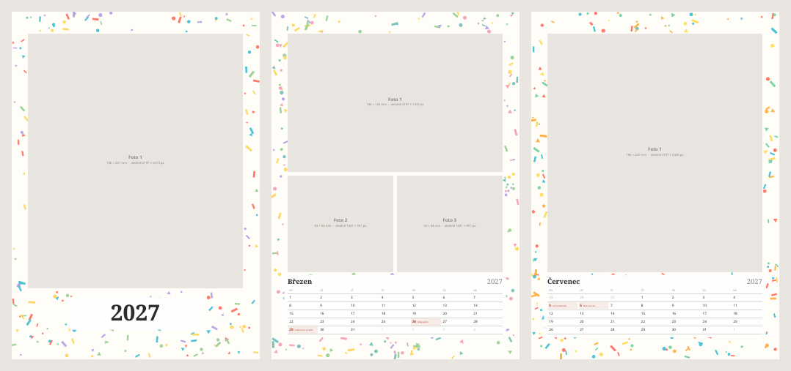

# Fotokalendář

Generátor nástěnného fotokalendáře z vlastních fotek: jednoduchý editor v prohlížeči + tisková PDF.
Česká jména měsíců, zvýrazněné **české státní svátky** (Velikonoce se dopočítají) a **bez červených nedělí**.

*English: a small tool for making a printable photo wall calendar (Czech month names and public holidays,
Sundays not in red). A browser editor lets you drop 1–4 photos per page, pick layouts, crop/zoom, reorder months
and choose a background; it outputs a print-ready PDF. UI and docs are in Czech.*



## Co umí

- 13 stran: titulka + 12 měsíců, A4 na výšku
- 6 rozložení fotek na stránku (1–4 fotky), ořez, přiblížení a posun výřezu
- přesouvání celých stránek mezi měsíci
- 6 pozadí: bílé, konfety, puntíky, vlny, scrapbook, kresbičky (barvy podle ročního období)
- upozornění na fotky s nízkým rozlišením
- výstup ve formátu pro tisk: 21,4 × 30,1 cm (A4 + 2 mm spadávka), 300 dpi, + náhled s vodítky

Formát odpovídá požadavkům tiskárny [onlineprinters](https://www.onlineprinters.cz) (Wire-o nástěnný kalendář A4, 13 listů, 4/0),
ale PDF použije jakákoli tiskárna, která bere A4 se spadávkou 2 mm.

## Instalace

Potřebuješ [uv](https://docs.astral.sh/uv/) (Python a knihovny si stáhne sám) a `pdftocairo` z balíku poppler
(Linux: `sudo apt install poppler-utils`, macOS: `brew install poppler`) – ten je potřeba jen pro náhled pozadí v editoru.

```sh
git clone https://github.com/OsaSoft/fotokalendar.git
cd fotokalendar
uv run app.py
```

Editor se otevře na http://127.0.0.1:8765.

## Použití

1. Fotky přetáhni do knihovny vlevo (nebo je nakopíruj do složky `fotky/`).
2. Přetahuj fotky do rámečků, u každé stránky vyber rozložení.
3. Kliknutím na vloženou fotku ji upravíš: tažením posuneš, kolečkem nebo +/− přiblížíš, ⟲ vrátí výchozí ořez.
4. Pořadí měsíců změníš tažením za ⠿ nebo šipkami ‹ ›.
5. **Vygenerovat PDF** vytvoří `out/kalendar-<rok>.pdf` (k tisku) a `out/kalendar-<rok>-nahled.pdf` (s vodítky: ořez, bezpečná zóna, vazba).

Vše se průběžně ukládá do `kalendar.toml` (vytvoří se z `kalendar.example.toml` při prvním spuštění).
Bez editoru: uprav `kalendar.toml` ručně a spusť `uv run kalendar.py`.

## Nastavení

V `kalendar.toml`:

| klíč | význam |
|---|---|
| `rok` | rok kalendáře (svátky se dopočítají) |
| `pozadi` | `zadne`, `konfety`, `puntiky`, `vlny`, `scrapbook`, `kresbicky` |
| `barva_svatku`, `barva_textu` | barvy (hex) |
| `[titulka]` | `nadpis`, `podnadpis`, `rozlozeni`, `fotky` |
| `[[mesic]]` ×12 | `rozlozeni` (`1`, `2`, `2v`, `3`, `3v`, `4`) a `fotky` |

Rozměry stránky, okraje a velikosti písma jsou konstanty na začátku `kalendar.py`.

## Soukromí

Složka `fotky/`, výstupy v `out/` a tvůj `kalendar.toml` jsou v `.gitignore` – do gitu se nedostanou.
Editor běží jen lokálně (127.0.0.1).

## Licence

Kód: MIT (viz `LICENSE`). Písma Noto Sans / Noto Serif: SIL Open Font License 1.1 (viz `fonts/OFL.txt`).
